<div align="center">



### Your AI agents can reason, plan, delegate and act.<br>Can you *prove* they were allowed to?

[](https://github.com/findajay/open-agent-trust/actions/workflows/ci.yml)
[](LICENSE)


**[▶ See it run](#-see-it-in-30-seconds)** ·
**[How it works](#-how-it-works)** ·
**[Use it in code](#-use-it-in-code)** ·
**[AgentProof spec](protocol/agentproof-v0.1.md)** ·
**[Roadmap](ROADMAP.md)**

</div>

<br>

OpenAgentTrust puts a gateway between AI agents and their tools. For every action it
checks **who** is asking and **who delegated** that authority, applies your **policy**,
asks a **human** when the policy says so, and seals the result into a signed
**AgentProof receipt**. Anyone can verify that receipt offline, without trusting the
agent framework, the gateway operator or you.

> [!NOTE]
> **Alpha.** v0.1 is a working reference implementation and a draft protocol. It has not
> had an independent security review yet. Feedback on the protocol is very welcome.

## 🎯 Logs tell you what happened. Receipts prove it was allowed.

| Question after an incident | Agent logs | AgentProof receipt |
|---|:---:|:---:|
| Which agent acted? | a name in a log line | ✅ Ed25519 signature on the exact request |
| Who gave it that authority? | ❌ | ✅ signed delegation chain back to your organization |
| Was it allowed to delegate further? | ❌ | ✅ every link can only *narrow* scope; verifier re-checks |
| Which policy decided, and would it decide the same today? | ❌ | ✅ policy digest + deterministic re-evaluation |
| Did a human approve *this exact* request? | a chat message, maybe | ✅ approver's signature over the request digest |
| Was the record edited afterward? | ❌ trust the log server | ✅ gateway signature + hash-chained ledger |
| Can an outside auditor check it? | ❌ needs your systems | ✅ `oat proof verify`, offline |

## ▶ See it in 30 seconds



You only need [uv](https://docs.astral.sh/uv/). No GPU, no cloud account, no API key.

```bash
git clone https://github.com/findajay/open-agent-trust.git
cd open-agent-trust
uv sync
uv run oat demo
```

The demo builds a small plant-maintenance world: an organization delegates to a planner
agent, which delegates a narrower scope to a maintenance agent. A shift supervisor must
approve pump restarts, and nobody may delete logs. Four requests go through the gateway,
the ledger is verified, and a tampered receipt is caught. Then verify any receipt yourself:

```bash
uv run oat proof verify oat-demo/receipts/02-pump.restart.json --trust oat-demo/trust.json --policy oat-demo/policy.yaml
```

## 🔍 How it works



<details>
<summary><b>What happens at each stage</b> (click to expand)</summary>
<br>

| Stage | The gateway… | Fails closed when… |
|---|---|---|
| **1 · Authenticate** | verifies the agent's signature, the request's freshness, that it isn't a replay, and the full delegation chain back to a trust anchor | any signature is invalid, a link expired, a link widened its parent's scope, or the scope doesn't cover the action |
| **2 · Decide** | evaluates your YAML policy: `deny` beats `require_approval` beats `allow` | no rule matches and the default is `deny` |
| **3 · Approve** | asks an approver listed by the matched rule to sign *this exact* request | the approval is missing, rejected, or signed by someone the rule didn't name |
| **4 · Execute** | runs the tool, records a digest of the result (never the result itself) | the decision wasn't `allow` or an approved `require_approval` |
| **Receipt** | signs everything above and links it to the previous receipt by hash | — every authenticated request gets one, denials included |

Requests that can't be attributed (bad signature, no valid delegation) get **no**
receipt: the gateway can't know who sent them, so it rejects them outright.

</details>

<details>
<summary><b>What a receipt looks like</b> (real output, signatures shortened)</summary>
<br>

```jsonc
{
  "type": "agentproof.receipt/v0.1",
  "issuer": "ed25519:m7jS9gvkaoUM6LcTP8AeX1Ozll_st3_wJBNr-LVeKUw",      // the gateway
  "request": {                                                          // signed by the agent
    "agent": "ed25519:CorKVL9nTieVOuAPVkQpG6Eq5I_XPViHBCqmk26HnXQ",
    "action": "pump.restart",
    "resource": "plant-7/pump/P-3",
    "arguments": { "reason": "low pressure alarm" },
    "signature": { "alg": "Ed25519", "value": "p0Y4tqv_X6xP…" }
  },
  "delegation_chain": [ /* org → planner-agent → maintenance-agent, each link signed */ ],
  "decision": {
    "effect": "require_approval",
    "policy_id": "plant-7-maintenance@1",
    "policy_digest": "sha256:998d165f…",                                // pins the exact policy
    "rule_id": "restart-needs-approval"
  },
  "approval": {                                                         // signed by the supervisor
    "approver": "ed25519:TAesKOSiv5OVlaJ-H9H7mg7doyiqgOpwd5sbGl3IaaQ",
    "request_digest": "sha256:2dfd0c04…",                               // this request, nothing else
    "decision": "approved",
    "reason": "Pressure confirmed low on site"
  },
  "outcome": { "status": "succeeded", "result_digest": "sha256:f4992da1…" },
  "prev": "sha256:46ab4a67…",                                           // hash of the previous receipt
  "signature": { "alg": "Ed25519", "value": "fcnojkVHGyZg…" }
}
```

</details>

<details>
<summary><b>What the verifier checks</b> (11 independent checks)</summary>
<br>

| Check | Passes when |
|---|---|
| `structure` | the receipt matches the AgentProof v0.1 schema exactly (no missing or extra members) |
| `gateway-trusted` | it was issued by a gateway key you trust |
| `gateway-signature` | the gateway's signature covers every byte |
| `request-digest` | the embedded request is the one the receipt refers to |
| `agent-signature` | the agent really signed that request |
| `timing` | the receipt wasn't issued before the request |
| `delegation-chain` | every link is signed, unexpired, linked to its parent and never wider than it |
| `delegation-scope` | every link permits this action on this resource |
| `policy-decision` | your copy of the policy reproduces the same decision (optional) |
| `approval` | the approval is signed by an approver the rule names, for this request |
| `enforcement` | nothing ran that the decision forbade, even if the gateway signed it |

Each check reports separately, so a failure tells you exactly what's wrong. Spec:
[§4 Verification](protocol/agentproof-v0.1.md#4-verification).

</details>

## 🧑‍💻 Use it in code

```python
from datetime import timedelta
from openagenttrust import (
    Gateway, Ledger, Policy, Scope, SigningKey,
    create_request, issue_delegation, verify_receipt,
)

org, agent, gateway_key = SigningKey.generate(), SigningKey.generate(), SigningKey.generate()

# 1. Authority: the organization lets the agent read sensors at plant 7 for one hour.
chain = [issue_delegation(org, agent.key_id,
                          Scope(actions=["sensor.*"], resources=["plant-7/*"]),
                          expires_in=timedelta(hours=1))]

# 2. Enforcement: every tool call goes through the gateway.
gateway = Gateway(gateway_key, Policy.load("policy.yaml"),
                  trust_anchors=[org.key_id], ledger=Ledger("receipts.jsonl"))
request = create_request(agent, "sensor.read", "plant-7/pump/P-3", {"unit": "bar"})
result = gateway.execute(request, chain, tool=lambda args: {"pressure": 1})

# 3. Proof: anyone with the public key ids can verify, offline.
report = verify_receipt(result.receipt, trust_anchors=[org.key_id],
                        gateways=[gateway_key.key_id])
assert report.ok
```

A runnable version with approvals is in [examples/quickstart.py](examples/quickstart.py).

## 🧭 Built for

<table>
<tr>
<td width="50%" valign="top">

**🛡️ Security and platform teams**<br>
One enforcement point for every agent, whatever framework built it. Least privilege
through delegation, deny-by-default policies, and approvals where risk is high.

</td>
<td width="50%" valign="top">

**📋 Audit, risk and compliance**<br>
Evidence an outside party can check without access to your systems. Every decision is
tied to a policy version, and every approval to a person's key.

</td>
</tr>
<tr>
<td valign="top">

**🤖 Agent builders**<br>
Three runtime dependencies and a ten-line integration. Your agent keeps its framework;
the gateway wraps its tool calls.

</td>
<td valign="top">

**🏭 Industrial and edge**<br>
Deterministic, offline-capable enforcement with no LLM supervising another LLM. Receipts
verify without a network connection.

</td>
</tr>
</table>

## 🔌 Works with Open Model Fabric

[Open Model Fabric](https://github.com/findajay/Open-model-fabric) routes your agents'
model calls across Ollama, vLLM and other engines. With the `omf` extra, each receipt
also records *which model, on which provider, under which routing policy* produced the
output that the action was based on:

```bash
uv sync --extra omf
OAT_OMF_TOKEN=<your OMF token> uv run oat demo --out oat-demo-omf --omf-url http://localhost:8080
```

The two projects stay independent: Open Model Fabric governs model access, and
OpenAgentTrust governs what agents do with it.

<details>
<summary><b>🛠️ CLI reference</b></summary>
<br>

| Command | Does |
|---|---|
| `oat keygen KEYFILE [--name N]` | Create an Ed25519 key file and print its key id |
| `oat key-id KEYFILE` | Print a key file's key id |
| `oat delegate --issuer-key F --subject K --action P --resource P [--parent F] [--may-delegate]` | Issue a delegation |
| `oat policy check POLICY --action A --resource R` | Show the decision a policy makes |
| `oat proof verify RECEIPT --trust FILE [--policy F] [--json]` | Verify one receipt |
| `oat ledger verify LEDGER --trust FILE [--policy F]` | Verify a whole receipt ledger |
| `oat schema [--out DIR]` | Write the AgentProof JSON Schemas |
| `oat demo [--out DIR] [--omf-url URL]` | Run the end-to-end demo |

</details>

<details>
<summary><b>❓ FAQ</b></summary>
<br>

**Is this another agent framework?**
No. It sits between whatever framework you use and the tools your agents call.

**Does it use an LLM to judge actions?**
No. Enforcement is deterministic: signatures, scopes and policy rules. Risk-adaptive
behavior comes from `require_approval` rules, not from a model supervising a model.

**What if the gateway itself is compromised?**
It can't forge agent requests, delegations or approvals. A verifier holding the policy
also catches false decisions, and the `enforcement` check catches receipts that claim
forbidden executions. See the [threat model](docs/threat-model.md) for what remains.

**Does it work with MCP?**
Today you call the gateway from your tool layer. An MCP proxy that enforces policy on
`tools/call` is the top item for v0.2.

**Can other languages verify receipts?**
That's the point of the [spec](protocol/agentproof-v0.1.md): canonical JSON, Ed25519,
[JSON Schemas](protocol/schemas/v0.1) and [test vectors](protocol/test-vectors/v0.1). A
TypeScript verifier is planned for v0.2.

</details>

## 🗺️ Roadmap

- [x] **v0.1:** AgentProof draft, reference gateway and verifier, CLI, Open Model Fabric evidence
- [ ] **v0.2:** MCP gateway, framework SDK helpers, revocation, OPA and Cedar policies, TypeScript verifier
- [ ] **v0.3:** Studio UI for exploring ledgers, PostgreSQL ledger, OpenTelemetry, KMS/HSM keys
- [ ] **Later:** cross-organization federation, signed model evidence, policy replay

Details in [ROADMAP.md](ROADMAP.md). Architecture: [docs/architecture.md](docs/architecture.md) ·
[ADRs](docs/adr).

## 🤝 Contributing

Issues and pull requests are welcome, especially protocol feedback and attempts to break
the verifier. Start with [CONTRIBUTING.md](CONTRIBUTING.md) and the
[code of conduct](CODE_OF_CONDUCT.md). Report vulnerabilities privately as described in
[SECURITY.md](SECURITY.md).

If OpenAgentTrust is useful to you, a ⭐ helps others find it.

## 📄 License

Apache License 2.0. See [LICENSE](LICENSE) and [NOTICE](NOTICE).
